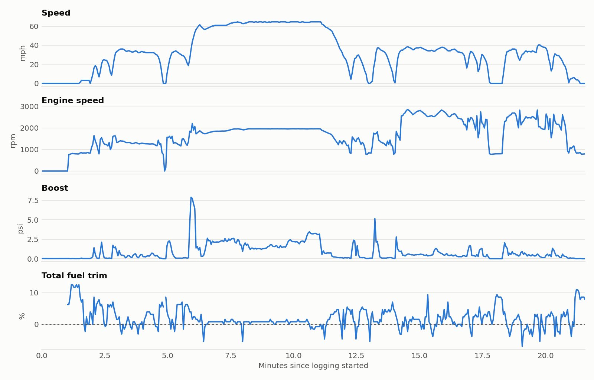

# CarPi

A Raspberry Pi that lives on my Audi's OBD-II port, asks the engine ECU for 25 live values about 8 times a second, and writes one CSV per drive.

**[Explore the drives in the viewer →](https://yurysergeev.github.io/carpi/)**

<picture>
  <source media="(prefers-color-scheme: dark)" srcset="docs/images/drive-trace-dark.png">
  
</picture>

<sub>The first baseline drive, Sept 2026. The fuel-trim spikes line up with idle. More on that <a href="docs/baseline-2026-09-25.md">below</a>.</sub>

## Why

I'm planning some mechanical work and eventually a Stage 1 tune on my 2017 A3 (EA888 Gen 3), and I wanted real before/after data rather than guesswork. Off-the-shelf OBD dongles show gauges; I wanted raw, timestamped logs I could compare in pandas.

It took two tries. In July, a passive `candump` on the OBD port showed exactly one frame: the gateway's keep-alive. The car's J533 gateway keeps powertrain traffic off the port, so there's nothing to listen to. In September I came back and made CarPi ask for each value instead.

## What it does

- **Polls the ECU over SocketCAN** with standard OBD-II Mode 01 requests, including a small hand-rolled ISO-TP layer for multi-frame replies (boost pressure).
- **Logs automatically.** It detects when the engine starts, opens a new CSV, and closes it when the ignition goes off. Nothing to start by hand.
- **Won't drain the battery.** It never transmits while the car's bus is asleep.
- **Survives power cuts.** The car's USB port dies instantly at ignition-off; `fsync` every 5 s and atomic metadata writes mean at most a few seconds are lost.
- **Lets the phone choose what to log.** Over Bluetooth LE, a small web app picks a preset: which values to read and how often, as a weight per value. Changing presets mid-drive closes the file and starts a new one. The same page shows chosen values live, with a warm-up card for cold starts, analyzes the drive being recorded or any saved drive (fuel trim by rpm band, ECU-style maps, events), and has a Settings tab for the Pi's Wi-Fi, a clean shutdown, its clock and time zone. [docs/phone-config.md](docs/phone-config.md)
- **Uploads drives by itself.** Whenever the Pi has internet (home Wi-Fi or the phone's hotspot), finished drives go to a private GitHub repo; a GitHub Action checks them and republishes the public [analyzer](https://carpi-analyzer.onrender.com). Switches on the phone turn automatic uploads or publishing off. [docs/data-sync.md](docs/data-sync.md)
- **Runs as systemd services.** The logger depends on nothing but `python-can`.
- **Turns logs into answers** on a PC: per-drive HTML reports with before/after comparison by tag, an interactive analyzer app, and the public [drive viewer](https://yurysergeev.github.io/carpi/).

How the polling, ISO-TP, presets and state machine work: [docs/how-it-works.md](docs/how-it-works.md)

## Hardware

| Part | Details |
| --- | --- |
| Car | 2017 Audi A3 8V, EA888 Gen 3, DQ250 DSG |
| Computer | Raspberry Pi 4 (2 GB), Raspberry Pi OS 13, headless |
| CAN interface | MCP2515 + SIT65HVD230 SPI CAN HAT (12 MHz crystal, IRQ on GPIO 25) |
| Cable | OBD-II pigtail: pin 6 → CAN-H, pin 14 → CAN-L |
| Power | The car's USB port |

The bus is 500 kbps high-speed CAN with 11-bit IDs (ISO 15765-4).

## Setup

**1. Enable the CAN HAT.** Add to `/boot/firmware/config.txt` and reboot:

```ini
dtparam=spi=on
dtoverlay=mcp2515-can0,oscillator=12000000,interrupt=25,spimaxfrequency=2000000
```

Some HATs use an 8 MHz crystal (`oscillator=8000000`). `dmesg | grep mcp251` should report `MCP2515 successfully initialized`.

**2. Install and enable the services.**

```bash
sudo apt install -y can-utils python3-can
git clone https://github.com/YurySergeev/carpi.git ~/carpi
sudo cp ~/carpi/systemd/*.service /etc/systemd/system/
sudo systemctl daemon-reload
sudo systemctl enable --now can0 carpi-logger
```

The logger unit assumes user `carpi` and the repo at `/home/carpi/carpi`. Adjust `systemd/carpi-logger.service` if yours differ.

**3. Optional: phone config over Bluetooth.** Install `python3-dbus python3-gi`, enable `carpi-ble.service`, and pair the phone once. Steps: [docs/phone-config.md](docs/phone-config.md).

## Usage

With the Pi plugged in and powered, every engine start becomes a new CSV in a folder per day: `~/carpi/logs/2026-09-26/drive-231349.csv`.

```bash
journalctl -u carpi-logger -f               # watch it live
echo post-pcv > ~/carpi/tag.txt             # label upcoming drives (or set it from the phone page)
git -C logs/carpi-data pull                 # on a PC: new drives, uploaded by the Pi (docs/data-sync.md)
```

To see what your car supports, stop the logger and run the probe:

```bash
sudo systemctl stop carpi-logger
python3 ~/carpi/probe_addressing.py          # addressing, supported PIDs, decoded values
python3 ~/carpi/probe_addressing.py --watch  # live values once a second
sudo systemctl start carpi-logger
```

Columns, decoding formulas and metadata: [docs/data-format.md](docs/data-format.md). The published drives are in [`data/`](data) if you want to poke at real numbers.

On a PC, with the drives in `logs/`:

```bash
python analyze_drives.py logs --open   # HTML report per drive + index with compare-by-tag (pandas, matplotlib)
python -m carpi_app                    # interactive analyzer at http://127.0.0.1:8050 (see carpi_app/README.md)
```

To publish a drive to the [viewer](https://yurysergeev.github.io/carpi/), copy it into `data/` with its day folder (`data/2026-09-26/drive-231349.csv`, since file names repeat across days), add an entry to [`data/drives.toml`](data/drives.toml) with `file = "2026-09-26/drive-231349.csv"`, and push. A GitHub Action tests the analysis, builds the page and deploys it. For a quick summary in the terminal: `python analysis/carpi_analysis.py <drive.csv>`.

## First results

On the first 21-minute drive, every decoded value matched a physical reference: boost equals barometric pressure at idle, actual λ tracks commanded λ, rail pressure and idle rpm land where they should.

One real finding: **total fuel trim is +8.6% at idle but under 1% while driving.** A correction that only shows up at idle usually means unmetered air, and on this engine the PCV valve is the classic suspect. The next logs will be tagged `post-pcv` for a before/after comparison.

Full report: [docs/baseline-2026-09-25.md](docs/baseline-2026-09-25.md)

## What's in this repo

| Path | What |
| --- | --- |
| `carpi_logger.py`, `carpi_presets.py` | The logger on the Pi, and the presets that choose what it reads |
| `carpi_ble.py`, `carpi_control.py`, `carpi_system.py`, `carpi_mgmt.py` | Bluetooth service for the phone page, its protocol, and the Pi/CAN readings it reports |
| `carpi_net.py`, `carpi_admin.py`, `pi-setup/` | The Settings tab: Wi-Fi through NetworkManager, shut down/restart, the clock and time zone, and the one-time permission setup (`sudo ~/carpi/pi-setup/install.sh`) |
| `carpi_stats.py`, `carpi_drives.py` | The Analysis tab: drive analysis on the Pi with the viewer's and the analyzer's definitions, and the drives it reads (saved ones, and the one being recorded) |
| `web/config/` | The phone page (Dashboard, Live, Analysis, Logging, Settings), served at [yurysergeev.github.io/carpi/config/](https://yurysergeev.github.io/carpi/config/) |
| `carpi_sync.py` | Uploads finished drives to the private `carpi-data` repo (backup, and the source of the public analyzer) |
| `systemd/` | `can0`, `carpi-logger`, `carpi-ble` and `carpi-sync` (timer, and a path unit for Upload now) |
| `probe_addressing.py`, `probe_oil.py` | One-off probes: what the car supports, and the oil-temperature check |
| `analyze_drives.py` | Per-drive HTML reports and compare-by-tag, on a PC |
| `carpi_app/`, `deploy/` | The analyzer app, and publishing it to Render: `publish.py`, the safety check `check_drives.py`, and `data-repo/` (the master copy of `carpi-data`'s README and publish workflow) |
| `analysis/`, `web/`, `data/` | The public drive viewer: analysis, page, and the published drives |
| `tests/` | Logger, presets, Bluetooth protocol, uploads, analysis and UDS tests (`python -m pytest tests -q`; run on every push) |
| `docs/` | How it works, data format, phone page, uploads, the baseline report |
| `CarPi_HANDOFF.md` | Current state and backlog, for picking the project up in a new session |

## Roadmap

- [ ] Clean shutdown on ignition-off (UPS HAT or ignition-sense power)
- [x] Drive-summary script: per-drive report and before/after comparison by tag (`analyze_drives.py`)
- [ ] Full-throttle baseline pulls before the tune
- [ ] VW-specific data over UDS: per-cylinder knock retard, oil temperature, DSG temperature
- [x] Choose what to log per drive from the phone (Bluetooth LE)
- [x] Live values and a cold-start warm-up card on the phone
- [x] Drive analysis on the phone: live and saved drives, maps, events
- [x] Automatic backup and publishing over any internet the Pi has
- [ ] Oil temperature (UDS `22 20 2F`, being confirmed against the dash with `probe_oil.py`)

## A note on safety

CarPi only reads. The logger sends standard OBD-II Mode 01 requests, the same ones any scan tool sends. The one-time oil check (`probe_oil.py`) adds a single UDS ReadDataByIdentifier (`0x22`) request, which can't change anything either. Nothing ever writes to the car, changes its diagnostic session or unlocks anything. Don't fiddle with it while driving.

## License

[MIT](LICENSE). Developed with help from [Claude](https://claude.ai).
