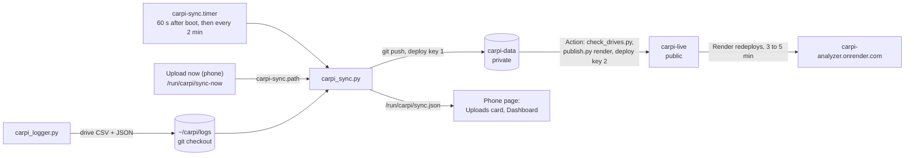

# Automatic uploads: backup and the public analyzer

Finished drives leave the Pi on their own. Whenever the Pi has internet (home Wi-Fi or the phone's
hotspot), it pushes them to a **private** GitHub repo, `carpi-data`. Each push there runs a GitHub
Action that checks the files and rebuilds the public [CarPi Analyzer](https://carpi-analyzer.onrender.com).
This replaces copying drives off the Pi with `scp` and running `publish.py render` by hand.



A drive uploads once it has ended. The Pi loses power at ignition-off, so that's usually early in
the next drive. A 30-minute drive is about 0.35 MB over the network (git compresses it), roughly
20 MB a month on the hotspot.

## What goes public

The analyzer gets every drive with at least 10 rows, raw: the CSV with its timestamps (so the date
and time of day of each drive), and the `.json` with its tag and preset. There's no GPS on the Pi,
so no locations. Left out:

- drives recorded while **Publish new drives** was off on the phone page (`"publish": false` in
  their `.json`). They're still backed up to `carpi-data`.
- identical copies, and drives under 10 rows.

**Hiding a drive that's already public:** on GitHub, open the drive's `.json` in `carpi-data`, add
`"publish": false`, and commit. The Action republishes without it within a few minutes. Each publish
replaces `carpi-live` with a single fresh commit, so the drive isn't in its history either (anyone
who already downloaded it keeps their copy). The Pi rebases onto your edit on its next upload.

## On the phone

**Settings → Uploads** shows the last result and has the controls:

| Control | What it does |
| --- | --- |
| **Upload automatically** | On (default): the timer uploads every 2 minutes. Off: drives wait on the Pi, counted on the card, until you tap Upload now. |
| **Publish new drives** | On (default). Off: new drives are marked private. The drive being recorded counts too, and stays private even if you switch publishing back on before it ends. |
| **Upload now** | One upload right away, even with automatic uploads off. |
| **Open the analyzer ↗** | The public site. |

The Dashboard's Car card has an **Upload** row with the same status line, plus "private" while
publishing is off. Both switches live in `~/carpi/upload.json` on the Pi. No file means both on; a
file that can't be read counts as publishing off.

## Setup (once)

Each step says where it runs. GitHub steps use the `gh` CLI, logged in as the repo owner.

1. **PC (PowerShell): create the private repo.**

   ```powershell
   gh repo create YurySergeev/carpi-data --private --description "CarPi drive logs, written by the Pi"
   ```

2. **PC: give it its README, ignore file and workflow** (master copies in `deploy/data-repo/`), and
   the label failed publishes are filed under.

   ```powershell
   git clone https://github.com/YurySergeev/carpi-data.git $env:TEMP\carpi-data
   robocopy deploy\data-repo $env:TEMP\carpi-data /E
   git -C $env:TEMP\carpi-data add -A
   git -C $env:TEMP\carpi-data commit -m "README, ignore file and publish workflow"
   git -C $env:TEMP\carpi-data branch -M main
   git -C $env:TEMP\carpi-data push -u origin main
   gh label create publish-failed -R YurySergeev/carpi-data --color B60205
   Remove-Item -Recurse -Force $env:TEMP\carpi-data
   ```

3. **Pi (SSH): get the code and make the Pi's upload key.** It prints the public half.

   ```bash
   cd ~/carpi && git pull
   python3 ~/carpi/carpi_sync.py --keygen
   ```

   It also writes GitHub's host key to `~/.ssh/known_hosts_github`, from a copy built into
   `carpi_sync.py` and checked against GitHub's published fingerprint. Nothing is fetched, and
   `~/.ssh/config` isn't touched.

4. **PC: let that key write to `carpi-data` only.** On GitHub: carpi-data → Settings → Deploy keys →
   Add deploy key. Paste the line from step 3, title it "CarPi Pi", and tick **Allow write access**.

5. **PC: a key for the Action to push to `carpi-live`.** Press Enter twice at the passphrase prompt
   (the Action can't type one).

   ```powershell
   ssh-keygen -t ed25519 -C "carpi-data publish" -f $env:TEMP\carpi_live
   gh repo deploy-key add $env:TEMP\carpi_live.pub -R YurySergeev/carpi-live --allow-write --title "carpi-data publish"
   Get-Content $env:TEMP\carpi_live -Raw | gh secret set CARPI_LIVE_KEY -R YurySergeev/carpi-data
   Remove-Item $env:TEMP\carpi_live, $env:TEMP\carpi_live.pub
   ```

6. **Pi (SSH), at home on Wi-Fi: install the units and upload everything.** The first upload sends
   every drive on the Pi, so it can take a few minutes.

   ```bash
   sudo cp ~/carpi/systemd/carpi-sync.service ~/carpi/systemd/carpi-sync.timer ~/carpi/systemd/carpi-sync.path ~/carpi/systemd/carpi-ble.service /etc/systemd/system/
   sudo systemctl daemon-reload
   sudo systemctl restart carpi-logger carpi-ble
   python3 ~/carpi/carpi_sync.py --setup
   sudo systemctl enable --now carpi-sync.timer carpi-sync.path
   ```

   `--setup` makes `~/carpi/logs` a checkout of `carpi-data` without touching the drive files in
   it, then uploads. It ends with a line like `{"state": "ok", "uploaded": 31, ...}`.

7. **PC: watch the first publish.** Then open the analyzer: the new drives should be listed.

   ```powershell
   gh run watch -R YurySergeev/carpi-data
   ```

8. **PC: get the drives locally.** The analyzer searches `logs/` recursively and skips identical
   copies, so the drives already copied there with `scp` do no harm.

   ```powershell
   gh repo clone YurySergeev/carpi-data logs\carpi-data
   ```

## Day to day

- **Phone:** the Upload row on the Dashboard; Settings → Uploads.
- **PC:** `git -C logs\carpi-data pull` for new drives.
- **Pi (SSH):** one upload with its output, then the log and the timer:

  ```bash
  python3 ~/carpi/carpi_sync.py --now
  ```

  ```bash
  journalctl -u carpi-sync -n 30
  ```

  ```bash
  systemctl list-timers carpi-sync.timer
  ```

Uploads run at the lowest CPU and disk priority, so they never slow the logger down.

## When something's wrong

| The card says | What it means |
| --- | --- |
| Not set up on this Pi yet | Steps 3 to 6 haven't been done on this Pi. |
| Waiting for internet | GitHub didn't answer within 20 s. Check Settings → Wi-Fi; on the road, turn on the phone's hotspot. Retries every 2 minutes. |
| Failed: Permission denied (publickey) | The deploy key from step 4 is missing, or doesn't have write access. |
| Failed: couldn't combine with newer changes on GitHub | The Pi and GitHub changed the same file. Unusual: the Pi never edits a drive after uploading it. `git -C ~/carpi/logs status` on the Pi shows which file. The drive files on the Pi aren't touched. |
| Failed: the upload stopped unexpectedly | A run took over 10 minutes or lost power. The next run cleans up: a stale lock is removed, and a damaged `.git` is moved aside (`.git.broken-<time>`) and rebuilt from GitHub. |
| (no Uploads card) | The Pi's software is older than this page: `cd ~/carpi && git pull && sudo systemctl restart carpi-ble carpi-logger` |

**A publish failed.** `carpi-data` gets an issue labelled `publish-failed` (later failures comment on
the same issue), and the analyzer keeps its last good build. The run's log says why. Most often the
safety check (`deploy/check_drives.py`) found a file that isn't a drive. It allows only
`YYYY-MM-DD/drive-HHMMSS.csv|json` and the older `drive-YYYY-MM-DD_HHMMSS.csv|json`, CSVs under
20 MB with known columns and numbers, and `.json` files with known keys. Fix or delete the file on
GitHub; the commit reruns the Action. **Actions → Publish analyzer → Run workflow** reruns it by hand.

**Replacing a key.** The Pi's: delete `~/.ssh/carpi_data` and `~/.ssh/carpi_data.pub` on the Pi, run
`--keygen` again, and swap the deploy key on `carpi-data`. The Action's: repeat step 5, then delete
the old deploy key on `carpi-live`.

## Why it's safe to leave running

- The Pi's key is a deploy key: it can write `carpi-data` and nothing else, and its private half
  never leaves the Pi. The Action's key can write `carpi-live` only.
- GitHub's host key is pinned on both sides, so a network in between (a café's Wi-Fi, say) can't
  pose as GitHub.
- If the Pi's key leaked, the safety check still stops anything that isn't a valid drive file from
  reaching the public site.
- Nothing here talks to the car, and the Bluetooth service only writes `upload.json` and the
  Upload-now trigger file.
