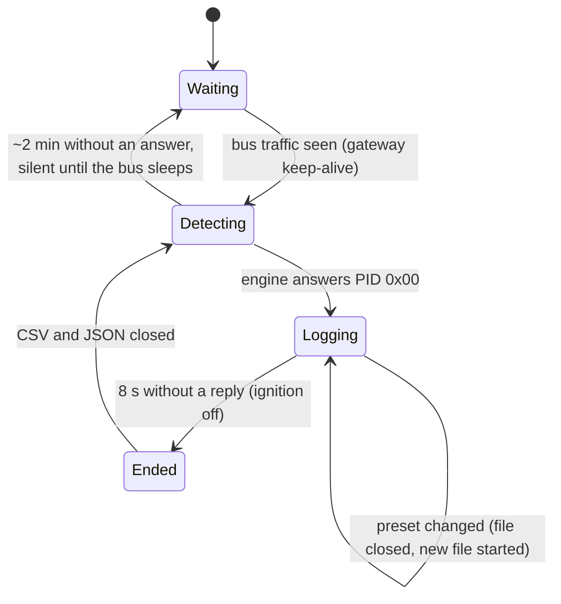

# How it works

## Why listening isn't enough

On the Audi's MQB platform, the J533 gateway keeps powertrain traffic off the OBD port. A passive `candump` with the engine running sees exactly one frame, the gateway's keep-alive:

```
(1783030596.181238) can0 17F00010#2010000000000000   # ~2 Hz, identical every time
```

So CarPi asks for every value it needs. A real exchange from the car:

| Step | CAN ID | Data | Meaning |
| --- | --- | --- | --- |
| Request | `0x7E0` | `02 01 0C 55 55 55 55 55` | Mode 01, PID `0x0C` (RPM), padded to 8 bytes |
| Reply | `0x7E8` | `04 41 0C 0C 77 …` | `0x0C77` / 4 = 797.75 rpm |

If the engine doesn't answer on its physical address (`0x7E0`), the logger falls back to the functional broadcast ID `0x7DF`.

## Multi-frame replies (ISO-TP)

Boost pressure (PID `0x70`) comes back as 12 bytes, too long for one CAN frame. The ECU sends a First Frame, CarPi answers with a Flow Control frame (`30 00 05`: send everything, 5 ms apart), and the ECU sends Consecutive Frames. The reassembly is about 20 lines in `Engine._receive()`, so `python-can` stays the only dependency. `Engine.request()` (OBD-II Mode 01) and `Engine.read_did()` (UDS `0x22`, below) both use it.

## Data path

```mermaid
flowchart LR
    ECU["Engine ECU<br/>J623"] <-->|powertrain CAN| GW["Gateway<br/>J533"]
    GW <-->|diagnostic CAN, 500 kbps| OBD["OBD-II port"]
    OBD <-->|pins 6 and 14| HAT["CAN HAT<br/>MCP2515"]
    HAT <-->|SPI0, IRQ GPIO 25| PI["Raspberry Pi 4<br/>carpi_logger.py"]
    PI -->|one CSV + JSON per drive| SD[("SD card<br/>~/carpi/logs")]
    PI -->|status.json, live.json<br/>(RAM)| BLE["carpi_ble.py"]
    BLE <-->|Bluetooth LE| PHONE["Phone<br/>web/config page"]
    PHONE -->|preset, tag| BLE
    BLE -->|active_preset.json, tag.txt| PI
    SD -->|scp| PC["PC<br/>analyzer, reports, viewer"]
```

The phone never talks to the car. `carpi_ble.py` only reads the logger's status files and writes the preset and tag files the logger reads. See [phone-config.md](phone-config.md).

## Logger states



- **Waiting:** listen only. Kernel-level CAN filters pass only engine replies (`0x7E8`) and the gateway keep-alive. Nothing is transmitted while the car is asleep, so the Pi can't wake it or drain the battery.
- **Detecting:** a `PID 0x00` request every 3 s, for at most ~2 minutes per bus wake-up.
- **Logging:** read the ECU's supported-PID bitmaps, then poll the values in the active preset, capped at 10 rows/s (`--hz`). Each value has a weight; values at the preset's top weight are read on every row, half the top weight every other row, and so on (`carpi_presets.Schedule`). The built-in default reproduces the original setup: 12 values on every row and 12 taking turns, one per row. Every second the logger checks whether the phone picked a different preset; if so, it closes the file and starts a new one.
- **Ended:** final `fsync`, and the metadata is marked complete.

## Surviving power cuts

The car's USB port drops power the moment the ignition turns off, so the logger assumes it can die at any time:

- the CSV is line-buffered and `fsync`ed every 5 s,
- the JSON metadata is written to a temp file and atomically renamed, every 30 s,
- a drive that never closed cleanly keeps `"complete": false`,
- a new drive never overwrites an old one, even when the clock repeats after a reboot (`-2`, `-3`… suffixes, files opened in exclusive mode).

At most about 5 s of data is lost per cut.

## VW-specific reads (UDS)

Some values, like oil temperature, aren't in standard OBD-II on this car. `Engine.read_did()` reads them with UDS ReadDataByIdentifier (service `0x22`): physical addressing, in the engine's current diagnostic session, with no session changes or security access. `0x22` can only read. If the engine refuses, it raises `NegativeResponse` with the reason. Identifiers get added one at a time, after they're confirmed on the car; the only one so far is the oil-temperature candidate `0x202F`, checked once with `probe_oil.py` ([phone-config.md](phone-config.md#oil-temperature-being-confirmed)).

## Files on the Pi

| Path | Written by | What |
| --- | --- | --- |
| `~/carpi/logs/YYYY-MM-DD/drive-HHMMSS.csv` + `.json` | logger | the drives ([data-format.md](data-format.md)) |
| `~/carpi/tag.txt` | phone or you | one word copied into each new drive's metadata |
| `~/carpi/active_preset.json` | phone | the preset in use (none = the built-in default) |
| `~/carpi/presets/<id>.json` | phone | presets saved from the phone |
| `~/carpi/supported.json` | logger | which values the car answers to, so the phone can grey out the rest |
| `~/carpi/probes/` | probes | `probe_addressing.py` and `probe_oil.py` results |
| `/run/carpi/status.json` | logger | state, current file, rows, request rate (RAM, every 2 s) |
| `/run/carpi/live.json` | logger | latest reading of every value, for the Live tab (RAM, every 0.5 s while logging) |
| `/run/carpi/clock_from_phone` | Bluetooth service | the phone page set the clock, so the logger's `clock_ok` is 1 (RAM) |
| `/etc/polkit-1/rules.d/50-carpi.rules` | `pi-setup/install.sh` | lets the Bluetooth service manage Wi-Fi and shut down/restart, nothing else ([pi-setup](../pi-setup/README.md)) |

Everything under `~/carpi` except the code is git-ignored, so `git pull` never touches it. `/run/carpi` is created by `carpi-logger.service` (`RuntimeDirectory=carpi`).

## Testing

The logger is tested against a simulated engine on a `python-can` virtual bus (`tests/`): a full drive with the multi-frame boost reply, preset changes mid-drive, a bad preset file, unsupported values, the live snapshot, and the UDS read (normal, refused, "response pending", multi-frame). The Bluetooth protocol, presets and Pi readings have their own tests there too. GitHub Actions runs them on every push (`.github/workflows/tests.yml`), alongside the viewer's tests (`pages.yml`). Run them locally with `python -m pytest tests -q`.
