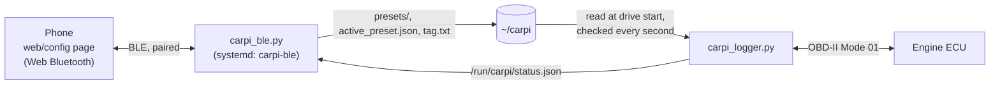

# Choosing what to log from the phone

CarPi can log a different set of values on each drive. You pick a **preset** on your phone over Bluetooth, and the logger uses it from that moment on.



The Bluetooth service never touches the CAN bus. It only edits a few small files that the logger reads. A preset can only pick from the logger's fixed list of standard read-only PIDs (`CATALOG` in `carpi_presets.py`), so nothing on the phone can make the Pi send a new kind of request.

## Presets and weights

Each value in a preset has a **weight** from 0 to 20:

- **0** means the value is off.
- Values at the preset's **top weight** are read on every CSV row.
- A value with **half** the top weight is read every other row, a quarter every fourth row, and so on.

The page shows the estimated rate for each value as you move the sliders. The estimate is based on about 100 requests a second, which is what this car manages, with rows capped at 10 per second (`--hz`). The page replaces that number with the real one once it has seen a drive.

| Built-in preset | What it's for |
| --- | --- |
| **Full (default)** | The original setup: 12 values on every row and 12 rotating, 24 in total. Logs are identical to the ones before presets existed. |
| **Fuel trim study** | Idle and vacuum-leak work (PCV before/after): trims, MAP, lambda and rpm on every row. |
| **Pulls (boost & timing)** | Hard acceleration: boost, timing, load, throttle, pedal, lambda and rail pressure on every row. |

You can copy a built-in preset or start a new one from scratch. Saved presets live on the Pi in `~/carpi/presets/<id>.json`.

If a preset leaves out any of rpm, speed, either fuel trim, coolant, commanded lambda, boost or baro, its drives won't open in the public GitHub Pages viewer. The page warns you about this. `carpi_app` and `analyze_drives.py` still work with any set of columns.

## Changing presets mid-drive

The Pi only gets power when the ignition is on, so a drive has usually started by the time the phone connects. When you apply a preset during a drive, the logger:

1. closes the current CSV cleanly (`"ended_by": "preset_change"` in its `.json`)
2. starts a new CSV with the new values right away. The new file's `.json` has `"follows": "<previous file>"`.

The short first file is kept and never deleted. If you never open the page, every drive uses the last preset you applied. Editing and saving the active preset also counts as applying it.

## One-time setup on the Pi

Run these **in an SSH session on the Pi** after pulling the new code (`cd ~/carpi && git pull`):

```bash
sudo apt install -y python3-dbus python3-gi
sudo cp ~/carpi/systemd/carpi-logger.service ~/carpi/systemd/carpi-ble.service /etc/systemd/system/
sudo systemctl daemon-reload
sudo systemctl restart carpi-logger          # picks up /run/carpi for the status file
sudo systemctl enable --now carpi-ble
journalctl -u carpi-ble -n 20                # want "GATT service registered" and "advertising as CarPi"
```

If it says no adapter was found, check `bluetoothctl show` (it should say `Powered: yes`) and run `sudo rfkill unblock bluetooth`.

## Pairing the phone (once per phone)

The Pi only accepts a new pairing during a short window that you open yourself, so nobody parked next to you can pair with it.

1. **In an SSH session on the Pi:**
   ```bash
   sudo python3 ~/carpi/carpi_ble.py --pair     # 120 s window
   ```
2. **On the phone** (Android: Chrome), open the config page, tap **Connect** and pick **CarPi**. Accept the pairing prompt that follows.

After that, the phone connects without the window. To remove a phone, run `bluetoothctl devices Paired` and then `bluetoothctl remove <MAC>` on the Pi, and tap **Forget** on the phone.

## The phone page

The page is at `https://yurysergeev.github.io/carpi/config/`. Web Bluetooth only works over HTTPS, which GitHub Pages provides. Its code is in `web/config/`.

- **Android:** use Chrome. Use **Add to Home screen** to keep it as an app. It still opens without signal, because a service worker keeps an offline copy.
- **iPhone:** Safari has no Web Bluetooth. Open the same address in the free **Bluefy** browser.
- **Demo:** add `?demo` to the address, or tap **Try the demo** in a browser without Bluetooth, to try the page against a simulated CarPi.

## Protocol (for adding features)

The protocol has one GATT service with two characteristics. The UUIDs are in `carpi_control.py`.

- **RX** (the phone writes): requests as JSON lines ending in `\n`, in chunks of any size.
- **TX** (the Pi notifies): one JSON line per reply, split to fit the link's MTU.

Commands are `hello`, `state`, `status`, `save`, `delete`, `activate` and `tag`. They're documented at the top of `carpi_control.py`, and `tests/test_control.py` exercises them. Both characteristics require an encrypted (paired) link.
