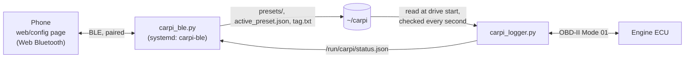

# The phone page: dashboard, live values and logging setup

After the phone connects, the page opens on a **Dashboard** tab. A **Live** tab shows chosen values about twice a second, with a warm-up card for cold starts, and a **Logging** tab holds the tag and the presets described below. The page remembers which tab you used last.

## Dashboard

The page asks the Pi for `status` every 2 seconds while it's open and in front. Three cards:

| Card | What it shows | Where it comes from |
| --- | --- | --- |
| **Bluetooth** | Live, not responding (no reply for 8 s), or disconnected; time since the last reply; round-trip time of the last request | The page itself |
| **Car and OBD-II** | Whether the Pi is plugged in and the car is awake, what the logger is doing, CAN controller state, frames per second, the current drive (length, rows, file), preset and tag | `carpi_system.py` (can0) + the logger's `/run/carpi/status.json` |
| **Raspberry Pi** | CPU temperature, CPU load, clock speed, memory, SD card space, uptime, and under-voltage / throttling flags | `carpi_system.py` (`/proc`, `/sys`) |

**How "plugged in" is decided.** The Pi only has power while the ignition is on, and with the ignition on the car's gateway sends a keep-alive frame on CAN about twice a second, even when the engine is off. `carpi_system.py` watches the kernel's receive counter for can0 (`/sys/class/net/can0/statistics/rx_packets`). Frames in the last 5 seconds means the OBD-II cable is in and the car is awake. No frames means the cable is out, or the car is asleep (only possible on bench power). It never opens a CAN socket, so it can't send anything to the car and works even while the logger is stopped.

| `obd.verdict` | Card says |
| --- | --- |
| `traffic` | Plugged in, plus the logger's state (engine running and logging, car awake with the engine off, …) |
| `quiet` | No CAN traffic: unplugged, or the car is asleep |
| `checking` | First reading after the service starts (frames per second needs two) |
| `down` | can0 exists but isn't up (`sudo systemctl restart can0`) |
| `bus_off` | The CAN controller gave up after too many errors: wiring or bitrate |
| `no_interface` | There's no can0: the HAT or the `mcp2515` overlay |

**Power flags.** "Under-voltage now" means the car's USB port isn't holding 5 V right now; "since boot" means it dipped at some point. They come from the firmware (`/sys/devices/platform/soc/soc:firmware/get_throttled`, the same value as `vcgencmd get_throttled`).

Try it without the car at `https://yurysergeev.github.io/carpi/config/?demo`, or `?demo=unplugged` for a Pi that's powered but not on the OBD port.

## Live

The **Live** tab shows the latest reading of the values you pick, refreshed about twice a second while the tab is on screen.

- **Values.** The chips list only what the active preset is collecting on this car, plus two worked-out values: **Boost** in psi (actual boost minus barometric pressure) and **Total fuel trim** (short + long). To watch something else live, add it to the preset on the Logging tab. Picking values here never changes what's logged.
- **Tiles.** A big number, its unit and, in the corner, how old the reading is. Values the preset reads less often show a larger age. A reading older than 5 seconds is greyed out. Tap a tile for a line of its last 60 seconds with the min and max; the line builds up from when the tab opens.
- **Units.** °C/°F and mph/km/h, remembered on the phone.
- **Warm-up card.** For cold starts: a stage, one line of advice, oil and coolant temperature, and a rough "full power in ~N min" from how fast the temperature rose over the last minute. Tap its header to collapse or expand it at any time; the phone remembers your choice. With no choice saved, it collapses by itself once the engine is warm.

| Stage | Oil | Coolant (stand-in) | Advice |
| --- | --- | --- | --- |
| Cold | under 60 °C | under 70 °C | Drive gently: under ~3,000 rpm, light throttle, no hard boost |
| Warming up | 60–80 °C | 70–90 °C | Normal driving is fine; save full throttle for later |
| Warm | 80 °C and up | 90 °C and up | Full power OK |

Until oil temperature is confirmed on this car (next section), the card runs on coolant and says so, with higher thresholds because coolant warms faster than oil. These are general warm-up guidelines, not Audi's numbers; the thresholds are at the top of the live section in `web/config/config.js`.

**How it works.** The logger already holds the latest reading of everything it polls. While it's reading the car it rewrites `/run/carpi/live.json` (RAM, not the SD card) twice a second, and the phone's `live` request reads that file through `carpi_ble.py`. The phone never makes the Pi send anything extra to the car. Try it without the car at `…/carpi/config/?demo` (a sped-up cold start) or `?demo=oil` (as if oil temperature were set up).

**Updating the Pi for the Live tab.** In an SSH session on the Pi: `cd ~/carpi && git pull && sudo systemctl restart carpi-logger carpi-ble`. An older Pi still works with the new page; the Live tab just explains that it needs this update.

## Oil temperature (being confirmed)

This A3's engine doesn't offer the standard OBD-II oil-temperature value (PID `0x5C`), so oil temperature needs a VW-specific read: UDS ReadDataByIdentifier, `22 20 2F`. That identifier is a candidate from earlier research and isn't confirmed on this car yet. Oil pressure isn't readable: this engine has pressure switches, not a sensor.

`probe_oil.py` checks it once, against the oil temperature the dash shows. It only sends `01 00`, `22 20 2F` and `01 05` (coolant, for comparison): no session change, no security access, no other identifiers. In an SSH session on the Pi, ideally from a cold start:

```bash
sudo systemctl stop carpi-logger
python3 ~/carpi/probe_oil.py --watch       # a reading every 2 s; Ctrl+C to stop
sudo systemctl start carpi-logger
```

Note what the dash shows for oil temperature, and the elapsed seconds on screen, at a few points as the engine warms (cold, about 60 °C, fully warm). The script prints the raw bytes and a few candidate conversions, and saves everything to `~/carpi/probes/oil-check-<time>.csv`. If one conversion tracks the dash at three or more points, the logger can read it as a normal value (`oil_c`) and the warm-up card switches to oil by itself. If the engine refuses the identifier, the script says so and stops; oil temperature then waits for a VW tool (VCDS) to confirm the right one.

## Choosing what to log

CarPi can log a different set of values on each drive. You pick a **preset** on your phone over Bluetooth, and the logger uses it from that moment on.



The Bluetooth service never touches the CAN bus. It only edits a few small files that the logger reads. A preset can only pick from the logger's fixed list of standard read-only PIDs (`CATALOG` in `carpi_presets.py`), so nothing on the phone can make the Pi send a new kind of request.

## Presets and weights

Each value in a preset has a **weight** from 0 to 20:

- **0** means the value is off.
- Values at the preset's **top weight** are read on every CSV row.
- A value with **half** the top weight is read every other row, a quarter every fourth row, and so on.

The page shows the estimated rate for each value as you move the sliders. The estimate is based on about 100 requests a second, which is what this car manages, with rows capped at 10 per second (`--hz`). The page replaces that number with the real one once it has seen a drive.

| Built-in preset | What it's for |
| --- | --- |
| **Full (default)** | The original setup: 12 values on every row and 12 rotating, 24 in total. Logs are identical to the ones before presets existed. |
| **Fuel trim study** | Idle and vacuum-leak work (PCV before/after): trims, MAP, lambda and rpm on every row. |
| **Pulls (boost & timing)** | Hard acceleration: boost, timing, load, throttle, pedal, lambda and rail pressure on every row. |

You can copy a built-in preset or start a new one from scratch. Saved presets live on the Pi in `~/carpi/presets/<id>.json`.

If a preset leaves out any of rpm, speed, either fuel trim, coolant, commanded lambda, boost or baro, its drives won't open in the public GitHub Pages viewer. The page warns you about this. `carpi_app` and `analyze_drives.py` still work with any set of columns.

## Changing presets mid-drive

The Pi only gets power when the ignition is on, so a drive has usually started by the time the phone connects. When you apply a preset during a drive, the logger:

1. closes the current CSV cleanly (`"ended_by": "preset_change"` in its `.json`)
2. starts a new CSV with the new values right away. The new file's `.json` has `"follows": "<previous file>"`.

The short first file is kept and never deleted. If you never open the page, every drive uses the last preset you applied. Editing and saving the active preset also counts as applying it.

## One-time setup on the Pi

Run these **in an SSH session on the Pi** after pulling the new code (`cd ~/carpi && git pull`):

```bash
sudo apt install -y python3-dbus python3-gi
sudo sed -i 's/^#\?\s*ControllerMode\s*=.*/ControllerMode = le/' /etc/bluetooth/main.conf
sudo systemctl restart bluetooth             # Bluetooth LE only (see below)
sudo cp ~/carpi/systemd/carpi-logger.service ~/carpi/systemd/carpi-ble.service /etc/systemd/system/
sudo systemctl daemon-reload
sudo systemctl restart carpi-logger          # picks up /run/carpi for the status file
sudo systemctl enable --now carpi-ble
journalctl -u carpi-ble -n 20                # want "GATT service registered" and "advertising as CarPi"
```

The unit runs `rfkill unblock bluetooth` before starting, because a soft-blocked adapter can't be powered on: BlueZ then logs `Failed to set mode: Failed (0x03)`. If it still fails, check `rfkill list` and `bluetoothctl show`. You want `Powered: yes`, not `PowerState: off-blocked`.

**Why LE only:** CarPi only talks Bluetooth LE, but the Pi's chip also does classic Bluetooth. If both are on, an Android phone pairs over LE and then derives a classic key from it ("cross-transport key derivation"). It then tries a classic connection to the Pi, and Android reports "Can't communicate with CarPi" when that goes nowhere. `ControllerMode = le` turns classic off. `sudo btmgmt -i hci0 info` should list `le` but not `br/edr` under current settings.

On Raspberry Pi OS 13, BlueZ refuses every advertisement, its own `bluetoothctl advertise on` included. `bluetoothd` then logs `Failed to add advertisement: Invalid Parameters (0x0d)`. When that happens, the service adds the advertisement directly to the kernel over its Bluetooth management socket (`carpi_mgmt.py`, the same thing `btmgmt add-adv` does). That's why the unit grants `CAP_NET_ADMIN`. The log then says `advertising as CarPi (via kernel: LE only, discoverable, name)`. BlueZ still handles the connection, pairing and the GATT service.

## Pairing the phone (once per phone)

The Pi only accepts a new pairing during a short window that you open yourself, so nobody parked next to you can pair with it.

1. **In an SSH session on the Pi:**
   ```bash
   sudo python3 ~/carpi/carpi_ble.py --pair     # 120 s window
   ```
2. **On the phone** (Android: Chrome), open the config page, tap **Connect** and pick **CarPi**. Accept the pairing prompt that follows.

After that, the phone connects without the window. To remove a phone, run `bluetoothctl devices Paired` and then `bluetoothctl remove <MAC>` on the Pi, and tap **Forget** on the phone.

## The phone page

The page is at `https://yurysergeev.github.io/carpi/config/`. Web Bluetooth only works over HTTPS, which GitHub Pages provides. Its code is in `web/config/`.

- **Android:** use Chrome. Use **Add to Home screen** to keep it as an app. It still opens without signal, because a service worker keeps an offline copy.
- **iPhone:** Safari has no Web Bluetooth. Open the same address in the free **Bluefy** browser.
- **Demo:** add `?demo` to the address, or tap **Try the demo** in a browser without Bluetooth, to try the page against a simulated CarPi.

## Protocol (for adding features)

The protocol has one GATT service with two characteristics. The UUIDs are in `carpi_control.py`.

- **RX** (the phone writes): requests as JSON lines ending in `\n`, in chunks of any size.
- **TX** (the Pi notifies): one JSON line per reply, split to fit the link's MTU.

Commands are `hello`, `state`, `status`, `live`, `save`, `delete`, `activate` and `tag`; `hello` reports the protocol version (2 since `live` was added). `live` returns the logger's latest readings for the columns the phone asks for, each with its age in seconds. `status` (and `state`, which includes it) returns three objects: `status` from the logger, `system` and `obd` from `carpi_system.py`, which `carpi_ble.py` samples every 2 seconds. They're documented at the top of `carpi_control.py`, and `tests/test_control.py` exercises them. Both characteristics require an encrypted (paired) link.
